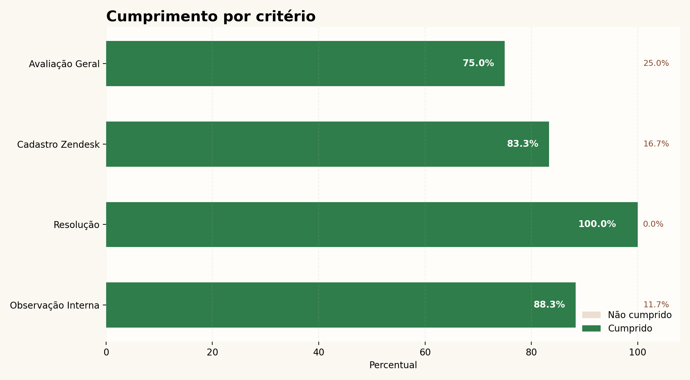
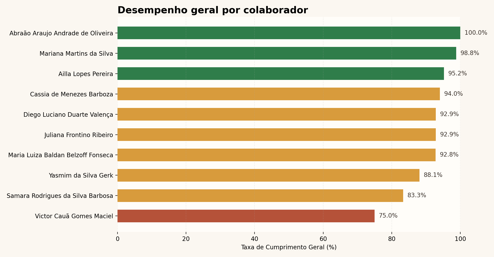

# Relatorio Semanal de Atendimentos Online - 19/10/2026 a 23/10/2026

**Data de Emissao:** 26/10/2026

## 1. Introducao

Este relatorio apresenta o desempenho dos atendimentos online com foco nos criterios Observacao Interna, Resolucao, Cadastro Zendesk e Avaliacao Geral do Atendimento.

## 2. Analise Consolidada dos Criterios

A tabela abaixo resume a taxa de cumprimento por criterio no periodo analisado.

| Criterio | Cumprido (%) | Nao Cumprido (%) | Total de Registros |
| --- | --- | --- | --- |
| Observacao Interna | 91.2% | 8.8% | 148 |
| Resolucao | 98.6% | 1.4% | 148 |
| Cadastro Zendesk | 89.2% | 10.8% | 148 |
| Avaliacao Geral do Atendimento | 81.8% | 18.2% | 148 |

## 3. Analise de Desempenho por Colaborador

O ranking a seguir mostra a taxa geral de cumprimento por colaborador com base nos criterios quantitativos aplicaveis.

| Colaborador | Taxa de Cumprimento Geral | Obs. Interna (C/NC) | Resolucao (C/NC) | Zendesk (C/NC) | Total de Atendimentos |
| --- | --- | --- | --- | --- | --- |
| Abraão Araujo Andrade de Oliveira | 100.0% | 20/0 | 20/0 | 20/0 | 20 |
| Ailla Lopes Pereira | 91.7% | 16/4 | 20/0 | 19/1 | 20 |
| Cassia de Menezes Barboza | 91.7% | 18/2 | 20/0 | 17/3 | 20 |
| Diego Luciano Duarte Valença | 95.0% | 18/2 | 20/0 | 19/1 | 20 |
| Juliana Frontino Ribeiro | 85.0% | 18/2 | 20/0 | 13/7 | 20 |
| Maria Luiza Baldan Belzoff Fonseca | 75.0% | 3/1 | 3/1 | 3/1 | 4 |
| Mariana Martins da Silva | 100.0% | 8/0 | 8/0 | 8/0 | 8 |
| Samara Rodrigues da Silva Barbosa | 95.0% | 20/0 | 19/1 | 18/2 | 20 |
| Victor Cauã Gomes Maciel | 93.8% | 14/2 | 16/0 | 15/1 | 16 |

**Legenda:** `C/NC` = Cumprido / Nao Cumprido.

## 4. Observacoes Adicionais

### Observações Detalhadas

**Abraão Araujo Andrade de Oliveira** - 0 ponto(s) de atencao, 20 ponto(s) positivo(s)
- ✅ Ticket 90627 | Ligação | Correto | Sem observação adicional.
- ✅ Ticket 90639 | Chat | Correto | Sem observação adicional.
- ✅ Ticket 90730 | Redes Sociais | Correto | Sem observação adicional.
- ✅ Ticket 90732 | Ligação | Correto | Sem observação adicional.
- ✅ Ticket 90992 | Chat | Correto | Sem observação adicional.
- ✅ Ticket 91045 | Ligação | Correto | Sem observação adicional.
- ✅ Ticket 91090 | Ligação | Correto | Sem observação adicional.
- ✅ Ticket 91139 | Chat | Correto | Sem observação adicional.
- ✅ Ticket 91298 | Ligação | Correto | Sem observação adicional.
- ✅ Ticket 91301 | Ligação | Correto | Sem observação adicional.
- ✅ Ticket 91307 | Chat | Correto | Sem observação adicional.
- ✅ Ticket 91322 | Chat | Correto | Sem observação adicional.
- ✅ Ticket 91658 | Chat | Correto | Sem observação adicional.
- ✅ Ticket 91668 | Chat | Correto | Sem observação adicional.
- ✅ Ticket 91701 | Ligação | Correto | Sem observação adicional.
- ✅ Ticket 91711 | Ligação | Correto | Sem observação adicional.
- ✅ Ticket 91781 | Chat | Correto | Sem observação adicional.
- ✅ Ticket 91966 | Ligação | Correto | Sem observação adicional.
- ✅ Ticket 91997 | Ligação | Correto | Sem observação adicional.
- ✅ Ticket 92039 | Chat | Correto | Sem observação adicional.

**Ailla Lopes Pereira** - 5 ponto(s) de atencao, 15 ponto(s) positivo(s)
- ✅ Ticket 90623 | Ligação | Correto | Sem observação adicional.
- ⚠️ Ticket 90650 | Chat | Atenção | Sem observação adicional.
- ✅ Ticket 90728 | Ligação | Correto | Sem observação adicional.
- ✅ Ticket 90817 | Chat | Correto | Sem observação adicional.
- ✅ Ticket 90976 | Chat | Correto | Sem observação adicional.
- ⚠️ Ticket 90986 | Chat | Atenção | Sem observação adicional.
- ✅ Ticket 91096 | Ligação | Correto | Sem observação adicional.
- ✅ Ticket 91154 | Ligação | Correto | Sem observação adicional.
- ✅ Ticket 91288 | Chat | Correto | Sem observação adicional.
- ✅ Ticket 91297 | Chat | Correto | Sem observação adicional.
- ✅ Ticket 91353 | Ligação | Correto | Sem observação adicional.
- ⚠️ Ticket 91373 | Ligação | Atenção | Sem observação adicional.
- ✅ Ticket 91712 | Ligação | Correto | Sem observação adicional.
- ✅ Ticket 91750 | Ligação | Correto | Sem observação adicional.
- ⚠️ Ticket 91766 | Chat | Atenção | Sem observação adicional.
- ✅ Ticket 91811 | Chat | Correto | Sem observação adicional.
- ✅ Ticket 91931 | Ligação | Correto | Sem observação adicional.
- ✅ Ticket 91950 | Chat | Correto | Sem observação adicional.
- ✅ Ticket 91957 | Ligação | Correto | Sem observação adicional.
- ⚠️ Ticket 92109 | Chat | Atenção | Sem observação adicional.

**Cassia de Menezes Barboza** - 5 ponto(s) de atencao, 15 ponto(s) positivo(s)
- ✅ Ticket 90416 | Ligação | Correto | Sem observação adicional.
- ✅ Ticket 90611 | Chat | Correto | Sem observação adicional.
- ✅ Ticket 90670 | Chat | Correto | Sem observação adicional.
- ✅ Ticket 90841 | Ligação | Correto | Sem observação adicional.
- ⚠️ Ticket 90956 | Ligação | Atenção | Sem observação adicional.
- ⚠️ Ticket 90968 | Chat | Atenção | Sem observação adicional.
- ⚠️ Ticket 90975 | Chat | Atenção | Sem observação adicional.
- ✅ Ticket 91165 | Ligação | Correto | Sem observação adicional.
- ✅ Ticket 91347 | Chat | Correto | Sem observação adicional.
- ✅ Ticket 91374 | Ligação | Correto | Sem observação adicional.
- ✅ Ticket 91376 | Chat | Correto | Sem observação adicional.
- ✅ Ticket 91395 | Ligação | Correto | Sem observação adicional.
- ✅ Ticket 91618 | Ligação | Correto | Sem observação adicional.
- ⚠️ Ticket 91620 | Ligação | Atenção | Sem observação adicional.
- ✅ Ticket 91690 | Chat | Correto | Sem observação adicional.
- ⚠️ Ticket 91829 | Chat | Atenção | Sem observação adicional.
- ✅ Ticket 92084 | Chat | Correto | Sem observação adicional.
- ✅ Ticket 92096 | Chat | Correto | Sem observação adicional.
- ✅ Ticket 92100 | Ligação | Correto | Sem observação adicional.
- ✅ Ticket 92124 | Ligação | Correto | Sem observação adicional.

**Diego Luciano Duarte Valença** - 3 ponto(s) de atencao, 17 ponto(s) positivo(s)
- ✅ Ticket 90712 | Ligação | Correto | Sem observação adicional.
- ✅ Ticket 90725 | Chat | Correto | Sem observação adicional.
- ✅ Ticket 90734 | Ligação | Correto | Sem observação adicional.
- ⚠️ Ticket 90766 | Chat | Atenção | Sem observação adicional.
- ✅ Ticket 91192 | Ligação | Correto | Sem observação adicional.
- ✅ Ticket 91220 | Chat | Correto | Sem observação adicional.
- ✅ Ticket 91226 | Ligação | Correto | Sem observação adicional.
- ✅ Ticket 91237 | Chat | Correto | Sem observação adicional.
- ✅ Ticket 91383 | Ligação | Correto | Sem observação adicional.
- ✅ Ticket 91400 | Ligação | Correto | Sem observação adicional.
- ⚠️ Ticket 91519 | Chat | Atenção | Sem observação adicional.
- ✅ Ticket 91523 | Chat | Correto | Sem observação adicional.
- ✅ Ticket 91801 | Ligação | Correto | Sem observação adicional.
- ⚠️ Ticket 91814 | Chat | Atenção | Sem observação adicional.
- ✅ Ticket 91830 | Chat | Correto | Sem observação adicional.
- ✅ Ticket 91840 | Ligação | Correto | Sem observação adicional.
- ✅ Ticket 92078 | Chat | Correto | Sem observação adicional.
- ✅ Ticket 92107 | Ligação | Correto | Sem observação adicional.
- ✅ Ticket 92119 | Chat | Correto | Sem observação adicional.
- ✅ Ticket 92122 | Ligação | Correto | Sem observação adicional.

**Juliana Frontino Ribeiro** - 7 ponto(s) de atencao, 13 ponto(s) positivo(s)
- ⚠️ Ticket 90747 | Ligação | Atenção | Sem observação adicional.
- ✅ Ticket 90784 | Ligação | Correto | Sem observação adicional.
- ✅ Ticket 90816 | Chat | Correto | Sem observação adicional.
- ✅ Ticket 90835 | Chat | Correto | Sem observação adicional.
- ✅ Ticket 91170 | Ligação | Correto | Sem observação adicional.
- ⚠️ Ticket 91184 | Chat | Atenção | Sem observação adicional.
- ✅ Ticket 91191 | Chat | Correto | Sem observação adicional.
- ⚠️ Ticket 91208 | Ligação | Atenção | Sem observação adicional.
- ✅ Ticket 91341 | Chat | Correto | Sem observação adicional.
- ✅ Ticket 91379 | Ligação | Correto | Sem observação adicional.
- ✅ Ticket 91384 | Chat | Correto | Sem observação adicional.
- ⚠️ Ticket 91388 | Ligação | Atenção | Sem observação adicional.
- ✅ Ticket 91639 | Chat | Correto | Sem observação adicional.
- ⚠️ Ticket 91787 | Ligação | Atenção | Sem observação adicional.
- ✅ Ticket 91799 | Ligação | Correto | Sem observação adicional.
- ⚠️ Ticket 91825 | Chat | Atenção | Sem observação adicional.
- ✅ Ticket 91976 | Ligação | Correto | Sem observação adicional.
- ✅ Ticket 91980 | Ligação | Correto | Sem observação adicional.
- ✅ Ticket 92027 | Chat | Correto | Sem observação adicional.
- ⚠️ Ticket 92174 | Chat | Atenção | Sem observação adicional.

**Maria Luiza Baldan Belzoff Fonseca** - 1 ponto(s) de atencao, 3 ponto(s) positivo(s)
- ✅ Ticket 90592 | Chat | Correto | Sem observação adicional.
- ✅ Ticket 90617 | Chat | Correto | Sem observação adicional.
- ✅ Ticket 90652 | Chat | Correto | Sem observação adicional.
- ⚠️ Ticket 90690 | Chat | Atenção | Sem observação adicional.

**Mariana Martins da Silva** - 0 ponto(s) de atencao, 8 ponto(s) positivo(s)
- ✅ Ticket 90738 | Ligação | Correto | Sem observação adicional.
- ✅ Ticket 90763 | Ligação | Correto | Sem observação adicional.
- ✅ Ticket 90863 | Chat | Correto | Sem observação adicional.
- ✅ Ticket 90876 | Chat | Correto | Sem observação adicional.
- ✅ Ticket 91716 | Chat | Correto | Sem observação adicional.
- ✅ Ticket 91723 | Chat | Correto | Sem observação adicional.
- ✅ Ticket 91755 | Chat | Correto | Sem observação adicional.
- ✅ Ticket 91810 | Chat | Correto | Sem observação adicional.

**Samara Rodrigues da Silva Barbosa** - 3 ponto(s) de atencao, 17 ponto(s) positivo(s)
- ✅ Ticket 90709 | Chat | Correto | Sem observação adicional.
- ✅ Ticket 90803 | Ligação | Correto | Sem observação adicional.
- ✅ Ticket 90849 | Chat | Correto | Sem observação adicional.
- ✅ Ticket 90859 | Ligação | Correto | Sem observação adicional.
- ⚠️ Ticket 91141 | Redes Sociais | Atenção | Sem observação adicional.
- ✅ Ticket 91147 | Ligação | Correto | Sem observação adicional.
- ✅ Ticket 91172 | Ligação | Correto | Sem observação adicional.
- ✅ Ticket 91227 | Chat | Correto | Sem observação adicional.
- ✅ Ticket 91377 | Chat | Correto | Sem observação adicional.
- ✅ Ticket 91386 | Chat | Correto | Sem observação adicional.
- ✅ Ticket 91527 | Chat | Correto | Sem observação adicional.
- ⚠️ Ticket 91560 | Chat | Atenção | Associado fez um questionamento, mas o acolhedor não lhe explicou e apenas direcionou para pedido
- ✅ Ticket 91768 | Ligação | Correto | Sem observação adicional.
- ✅ Ticket 91827 | Chat | Correto | Sem observação adicional.
- ⚠️ Ticket 91845 | Chat | Atenção | Sem observação adicional.
- ✅ Ticket 91850 | Ligação | Correto | Sem observação adicional.
- ✅ Ticket 92089 | Redes Sociais | Correto | Sem observação adicional.
- ✅ Ticket 92116 | Ligação | Correto | Sem observação adicional.
- ✅ Ticket 92120 | Ligação | Correto | Sem observação adicional.
- ✅ Ticket 92126 | Ligação | Correto | Sem observação adicional.

**Victor Cauã Gomes Maciel** - 3 ponto(s) de atencao, 13 ponto(s) positivo(s)
- ✅ Ticket 90953 | Ligação | Correto | Sem observação adicional.
- ✅ Ticket 90954 | Ligação | Correto | Sem observação adicional.
- ✅ Ticket 90972 | Chat | Correto | Sem observação adicional.
- ⚠️ Ticket 91001 | Chat | Atenção | Sem observação adicional.
- ⚠️ Ticket 91290 | Chat | Atenção | Sem observação adicional.
- ✅ Ticket 91305 | Ligação | Correto | Sem observação adicional.
- ✅ Ticket 91351 | Ligação | Correto | Sem observação adicional.
- ⚠️ Ticket 91380 | Chat | Atenção | Sem observação adicional.
- ✅ Ticket 91705 | Ligação | Correto | Sem observação adicional.
- ✅ Ticket 91784 | Ligação | Correto | Sem observação adicional.
- ✅ Ticket 91802 | Chat | Correto | Sem observação adicional.
- ✅ Ticket 91808 | Chat | Correto | Sem observação adicional.
- ✅ Ticket 91940 | Ligação | Correto | Sem observação adicional.
- ✅ Ticket 92016 | Chat | Correto | Sem observação adicional.
- ✅ Ticket 92021 | Chat | Correto | Sem observação adicional.
- ✅ Ticket 92031 | Ligação | Correto | Sem observação adicional.

## 5. Conclusoes e Recomendacoes

- **Pontos Fortes:** O critério de Resolução continua apresentando um bom desempenho geral, indicando que a equipe tem sido eficaz nesse aspecto do atendimento.
- **Pontos de Melhoria:** Cadastro Zendesk e Observação Interna são os pontos que necessitam de maior atenção, com percentuais de cumprimento que indicam oportunidades de melhoria.
- **Recomendacoes:**
1.1 Treinamento Contínuo: Reforçar treinamentos sobre a importância e o processo correto de registro na Zendesk e a qualidade das observações internas.

Atenciosamente, Hemily Marques
